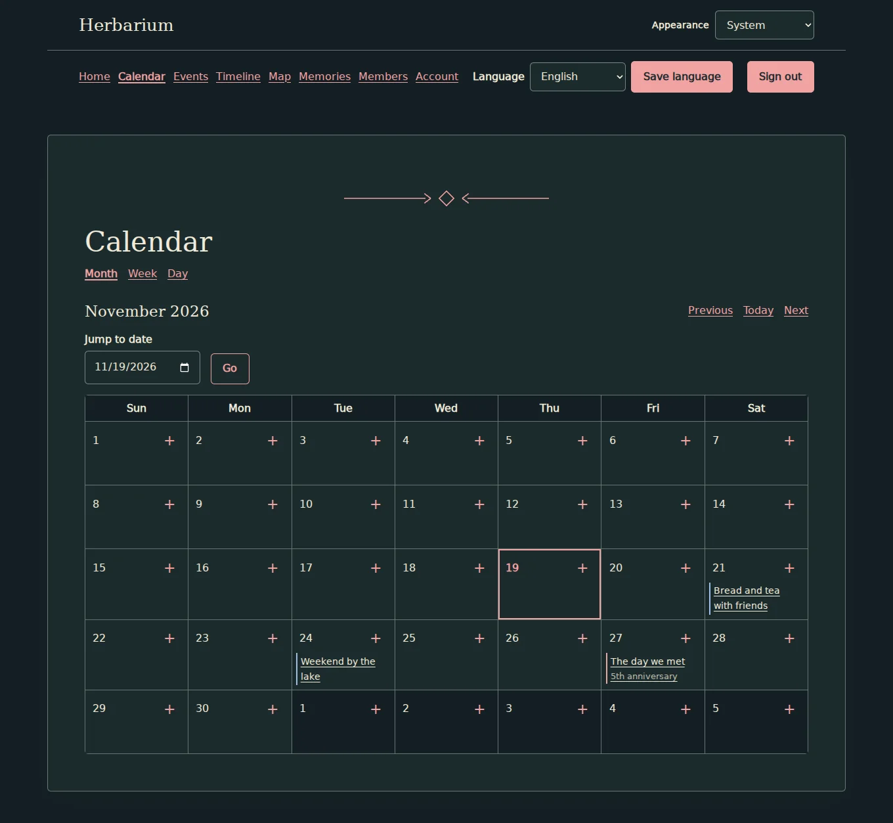
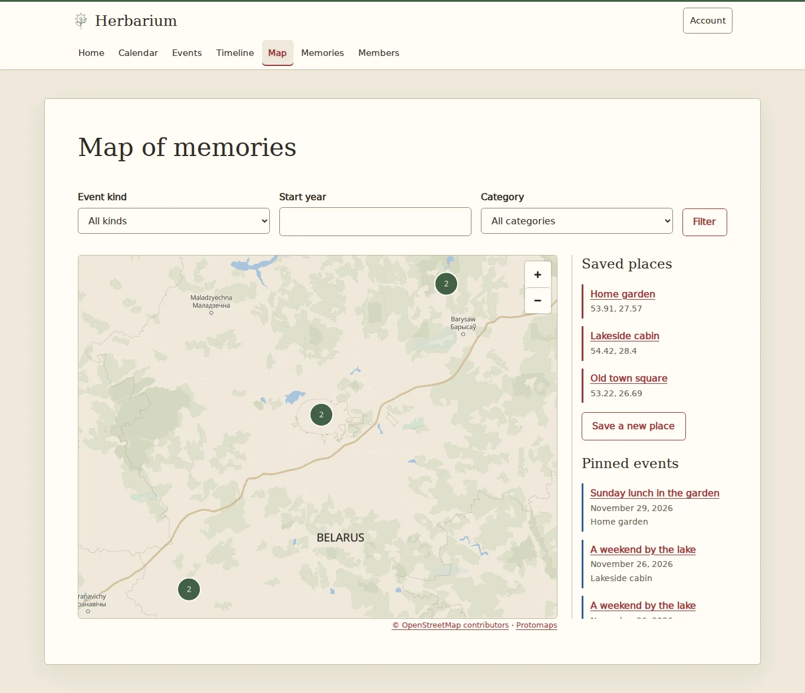
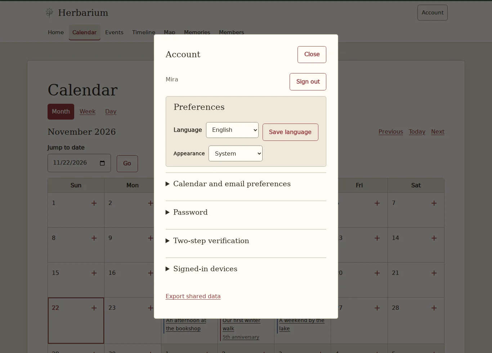

# Herbarium

Herbarium is a self-hosted shared calendar and chronicle for a couple, a family or a close circle of friends. It brings plans, anniversaries and memories into one private space, with a linen theme and a dark Kupalle theme inspired by Belarusian botanical art.

## What you can do

- Record past moments and recurring occasions in **Events**. Use **Plans** to collect ideas, set dates and record what happened.
- Choose a day, month, year or time when dating an event. Birthdays and anniversaries repeat yearly. For another occasion, choose an interval such as every two weeks. Browse the calendar by month, week or day, and opt in to reminder emails.
- Browse photos and videos by event or album in **Memories**. Import a folder to group files by capture date. Open a preview for a closer look, then choose **Open details** for file information.
- Keep a shared address book on the self-hosted map. Save places like home or a favorite campsite, then add several stops to a trip. A saved place rename reaches all linked stops. Each stop keeps its recorded coordinates.
- Invite people into a shared instance and use Herbarium in Belarusian, Russian or English. Install it from a compatible browser to open it from your home screen.
- Keep encrypted backups and export shared data with the original media for portable restores.

## Places and preferences

In **Map**, choose **Save a new place**, enter a name, and search, drop a pin or enter coordinates. Select a saved place by name to update it. In the event editor, use **Choose a saved place** or enter a new one, then **Add another place** for the next stop.

Open **Account** from any section to change language, appearance, reminders or security settings. Close the popup to return to the same view.

## Deploy

Herbarium runs as one Docker container with a data volume for the encrypted SQLite database, encrypted media and optional basemap. Put a reverse proxy with HTTPS in front of the container and set `ORIGIN` to the public URL. Then use the one-time setup code to create the first owner and send invitations from **Members**.

The deployment guide includes Docker Compose, a Caddy example, configuration and backup and restore procedures. Keep the master key somewhere safe and separate from your backup. Losing the key makes the encrypted data unrecoverable. [Deployment guide](docs/deployment.md#quick-start) · [Configuration reference](docs/deployment.md#configuration)

## Develop

The project is licensed under GPL-3.0. The documentation index covers architecture, local setup and the roadmap. [Documentation index](docs/README.md) · [License](LICENSE)
