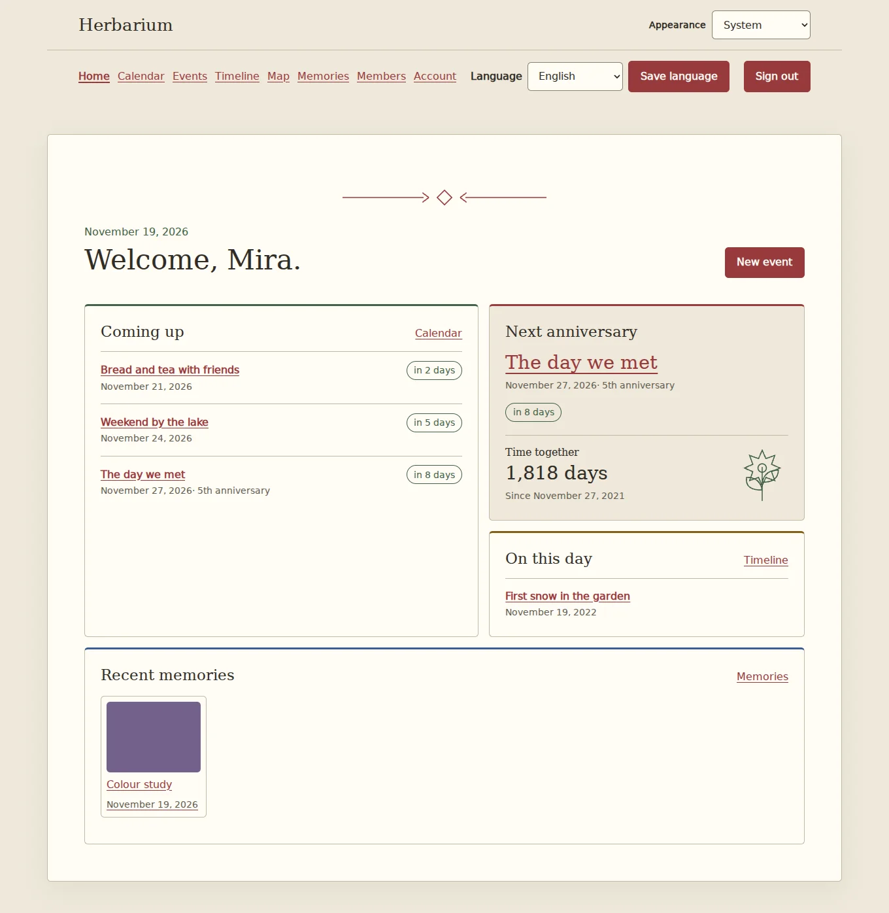

# Herbarium

Herbarium is a self-hosted shared calendar and chronicle for a couple, a family or a close circle of friends. It brings plans, anniversaries and memories into one private space, with a linen theme and a dark Kupalle theme inspired by Belarusian botanical art.

## What you can do

- Record moments with exact or approximate dates, plan upcoming events and mark them complete when they happen.
- Track birthdays and anniversaries, browse the calendar by month, week or day, and opt in to email reminders.
- Upload photos and videos, organize albums, or import a folder and group files by capture date.
- Browse a timeline and pin events on a self-hosted map. Choose whether to use a photo’s suggested location.
- Invite people into a shared instance and use Herbarium in Belarusian, Russian or English. Install it from a compatible browser to open it from your home screen.
- Keep encrypted backups and export shared data with the original media for portable restores.

## Deploy

Herbarium runs as one Docker container with a data volume for the encrypted SQLite database, encrypted media and optional basemap. Put a reverse proxy with HTTPS in front of the container and set `ORIGIN` to the public URL. Then use the one-time setup code to create the first owner and send invitations from **Members**.

The deployment guide includes Docker Compose, a Caddy example, configuration and backup and restore procedures. Keep the master key somewhere safe and separate from your backup. Losing the key makes the encrypted data unrecoverable. [Deployment guide](docs/deployment.md#quick-start) · [Configuration reference](docs/deployment.md#configuration)

## Develop

The project is licensed under GPL-3.0. The documentation index covers architecture, local setup and the roadmap. [Documentation index](docs/README.md) · [License](LICENSE)
